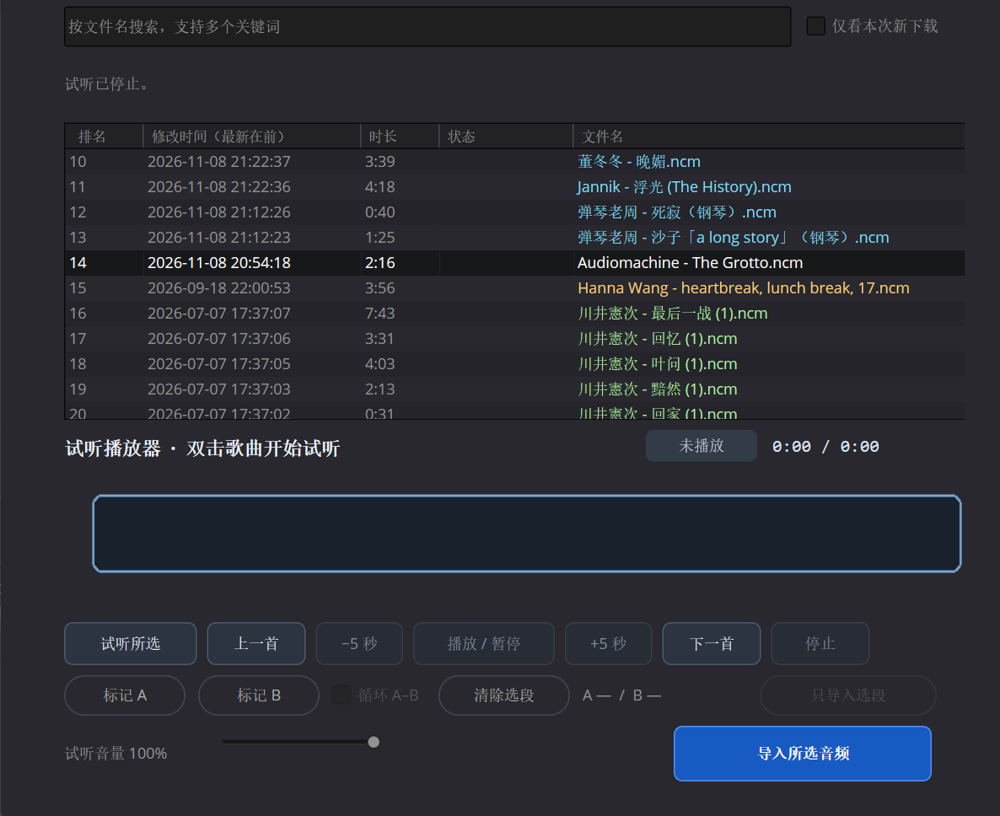

# 网易云配乐导入

「网易云配乐导入」是一个面向 Windows 版 DaVinci Resolve Studio 的配乐脚本。它把网易云音乐客户端下载到本地的歌曲列在达芬奇里，方便剪辑时筛选、试听、标记片段，并批量导入当前项目的媒体池。

截图取自较早版本，展示歌曲列表、试听区和导入按钮。

## 功能

- **找歌** · 从面板打开网易云音乐客户端。下载后刷新列表，可按文件名搜索、按修改时间排序，或只看本次打开面板后新下载的文件。
- **试听** · 双击曲目即可试听。可点击播放条跳转、拖动播放头，或按空格暂停和继续。需要看波形时，点「加载波形」。
- **选段** · 标记 A、B 点后可循环试听，也可以只导入选中的一段。
- **转码** · NCM 在本地处理。内含 MP3 的文件直接提取音频，内含 FLAC 的文件转成 320 kbps MP3。可自选 MP3 保存目录。
- **批量导入** · 支持 Ctrl 点选和 Shift 连选。音频导入当前项目的「网易云音乐」素材箱，后续导入会复用该素材箱。

## 安装

面向 **Windows x64 和 DaVinci Resolve Studio 21.2**。搜索和下载歌曲需要 Windows 版网易云音乐客户端。

1. 从 [Releases](https://github.com/chowjl/resolve-netease-music/releases/latest) 下载并完整解压 Windows 安装包，双击 `Install.cmd`。
2. 等窗口显示 `Installed`，然后启动或重启达芬奇。若电脑上没有可用的 FFmpeg，安装程序会联网下载约 100 MB，并校验 SHA-256。
3. 打开一个项目，从 **工作区 → 脚本 → 网易云配乐导入** 进入面板。英文界面的菜单为 **Workspace → Scripts**。
4. 首次打开时，选择网易云音乐客户端的下载目录，然后点「刷新列表」。

具体操作见[使用说明](使用说明.md)。

## 素材保存

试听文件临时生成。导入媒体池的素材引用磁盘上的文件，请保留导入后对应的文件及路径。重新安装脚本会保留已设置的网易云下载目录和 MP3 保存目录。

## 项目文件

| 文件 | 用途 |
| --- | --- |
| `网易云配乐导入.py` | 达芬奇面板、试听、转码和媒体池导入 |
| `Install.cmd`、`Install.ps1` | Windows 安装入口和依赖配置 |
| `使用说明.md` | 安装、试听和导入操作 |

NCM 容器格式参考 [ncmdump 1.5.1](https://github.com/taurusxin/ncmdump/blob/1.5.1/src/ncmcrypt.cpp)。安装程序从 [Gyan 的 FFmpeg 发布页](https://github.com/GyanD/codexffmpeg/releases/tag/8.1.1)获取 Windows 构建。
